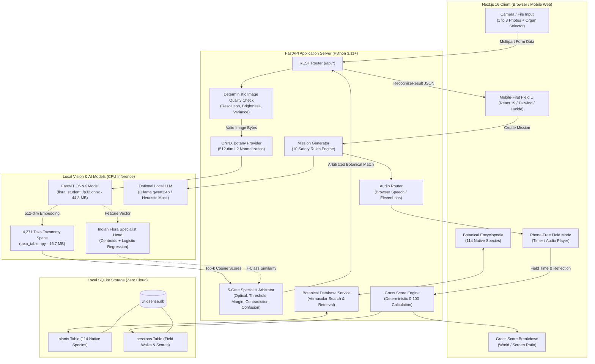
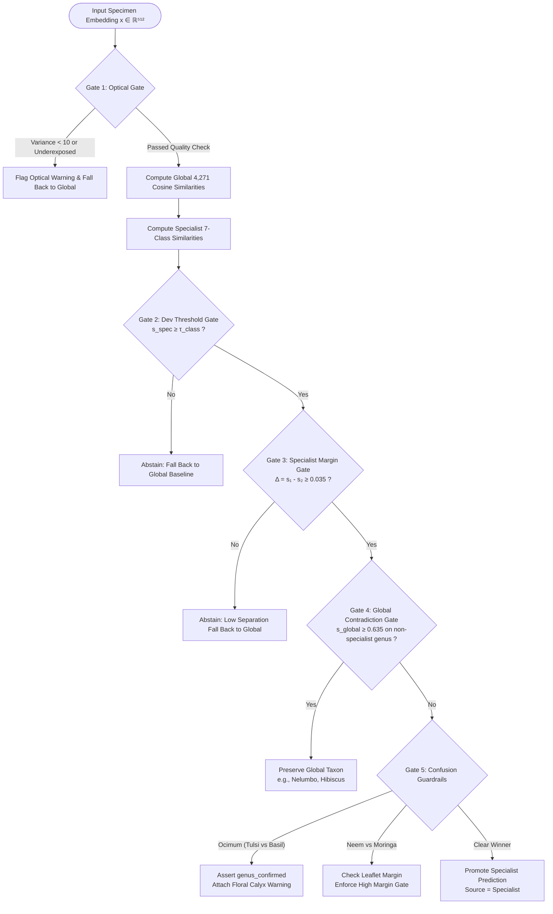

# WildSense System Architecture

> **System Overview**: Offline-First Local AI Nature Exploration Companion  
> **Target Platform**: Local CPU Inference (Intel Core i3-1115G4 / 12 GB RAM / Windows)  
> **Privacy Model**: 100% Local Inference, Zero Cloud Image Transmission, In-Memory Processing

---

## 1. High-Level Architectural Diagram

The diagram below illustrates the end-to-end data flow across client presentation, REST endpoints, deterministic safety gates, ONNX metric embedding inference, specialist arbitration, and local persistence.

---

## 2. Multi-Gate Specialist Arbitration Architecture

When `ENABLE_INDIAN_FLORA_SPECIALIST=true` is enabled, the dual-model arbitration engine evaluates candidate predictions across 5 sequential validation gates:

---

## 3. Core Subsystems & Components

### A. Frontend Presentation Layer (`frontend/`)
- **Framework**: Next.js 16.4 with Turbopack, React 19, and Tailwind CSS.
- **Mobile Field Companion**: Designed specifically for handheld mobile browsers with a dark-mode palette (`#0b110d`), tactile touch targets ($\ge 44$px), and zero distracting elements.
- **State Machine**:
  - `home` → Entry point with offline system badges and philosophy guide.
  - `explore` → Organ selection (**Leaf**, **Flower**, **Fruit**, **Bark**, **Whole Plant**) and camera upload.
  - `analyzing` → Local inference animation.
  - `mission_preview` → Botanical candidate card with similarity metrics, match levels, and audio narration controls.
  - `field_mode` → Screen-off countdown timer with minimal battery footprint.
  - `reflection` → User sensory log (texture, aroma, perimeter observations).
  - `score` → Grass Score visualization and lifetime discovery milestone.
- **Offline Botanical Encyclopedia**: Dynamic client modal for searching 114 native species by common name, scientific name, or ecological category.
- **Dynamic Network Resolution**: Client-side `getApiBase()` dynamically maps API calls to the hosting machine's local IP address (`192.168.x.x:8000`), enabling mobile phones on Wi-Fi to communicate without configuration.

### B. REST API & Service Layer (`backend/api/` & `backend/services/`)
- **FastAPI Core**: High-concurrency asynchronous ASGI server running via Uvicorn on port 8000.
- **`recognizer.py`**:
  - Central façade coordinating optical quality pre-checks, ONNX botanical inference, and fallback handling.
- **`onnx_botany_provider.py`**:
  - Manages FastViT ONNX Runtime sessions (`InferenceSession`) on local CPU.
  - Implements image preprocessing (Bicubic resize to $256 \times 256$, CenterCrop to $224 \times 224$, ImageNet normalization: $\mu=[0.485, 0.456, 0.406]$, $\sigma=[0.229, 0.224, 0.225]$).
  - Performs multi-photo L2-normalized vector fusion across up to 3 views.
- **`specialist_arbitrator.py`**:
  - 5-gate rule engine deciding between global 4,271-taxa baseline vectors and regional 7-class specialist centroids.
- **`mission_generator.py`**:
  - Generates context-aware real-world observation tasks strictly conforming to the **10 Nature Mission Safety Rules**.
- **`grass_score.py`**:
  - Calculates explainable 0–100 Grass Score using piecewise mathematical mapping over the World-to-Screen ratio.
- **`plant_service.py` & `journal.py`**:
  - SQLAlchemy SQLite managers for querying encyclopedia entries and persisting exploration session logs.

### C. Vision Model & Metric Embedding Space
- **Model Backbone**: `flora_student_fp32.onnx` (44.8 MB) — a distilled FastViT mobile architecture trained on extensive botanical corpora.
- **Metric Embedding**: Generates a 512-dimensional continuous feature vector $z \in \mathbb{R}^{512}$, normalized such that $\|z\|_2 = 1.0$.
- **Global Taxonomy**: `taxa_table.npy` (16.7 MB) represents 4,271 pre-computed taxonomy class centroid vectors.
- **Similarity Metric**: Cosine dot product $s = \langle z, c_k \rangle$, where $s \in [-1.0, 1.0]$. The system strictly formats this as a similarity metric and never mislabels it as a probability.

### D. Persistence Layer (`data/wildsense.db`)
- Standard SQLite database initialized automatically on startup via `init_db()`.
- **Tables**:
  - `plants`: 114 native species with canonical names, botanical descriptions, regional vernacular names (Hindi, Bengali, Tamil), diagnostic traits, and traditional uses.
  - `sessions`: Individual user walks, screen durations, field durations, calculated Grass Scores, observations, and reflection notes.

---

## 4. Security, Isolation, and Privacy Guarantees

1. **Zero External Vision Telemetry**:
   - Camera image bytes never cross the network boundary. All ONNX tensor allocations occur within local process memory.
2. **In-Memory Volatility**:
   - Uploaded photos are read into `io.BytesIO` buffers, decoded by Pillow, transformed to NumPy arrays, and garbage-collected immediately. No unencrypted photo cache remains on disk.
3. **CORS & Network Binding**:
   - The FastAPI backend binds to `0.0.0.0:8000` to allow local LAN mobile testing while restricting CORS headers to localhost and RFC 1918 private subnets (`192.168.x.x`, `10.x.x.x`, `172.16-31.x.x`).
